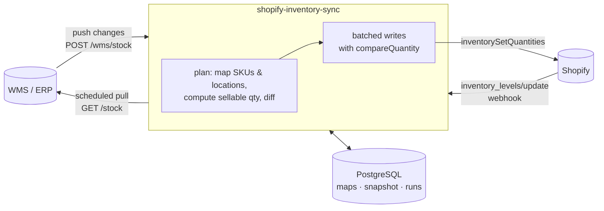

# shopify-inventory-sync

Keep **Shopify multi-location inventory** in sync with your **WMS or ERP** — webhook-driven, batched, and safe against overselling.


Shopify tracks stock per location, but it isn't your source of truth — your warehouse is. When the two drift you oversell, cancel orders and lose customers. This service makes the warehouse the source of truth and pushes **sellable** stock to the right Shopify location, quickly and without clobbering sales that happen mid-sync.

## Features

- **Warehouse → Shopify location mapping** — several WMS warehouses or bins can roll up into one Shopify location
- **Sellable stock, not raw stock** — `onHand − reserved − safetyBuffer`, never below zero
- **Oversell-safe writes** — uses Shopify's `compareQuantity` so a write is rejected if a sale landed since the last sync; the next run self-heals
- **No-op suppression** — only changed levels are written, tracked in a PostgreSQL snapshot
- **Batched GraphQL** — up to 250 quantities per `inventorySetQuantities` mutation
- **Throttle-aware client** — reads Shopify's query-cost bucket and waits exactly as long as needed
- **Two ways in** — the WMS pushes changes to `POST /wms/stock`, and a scheduled full reconciliation catches anything missed
- **Secure webhooks** — HMAC-verified, de-duplicated by webhook id, acknowledged fast
- **Audit trail** — every run is recorded with changed / unchanged / skipped counts and errors
- **Pluggable adapters** — generic REST adapter included; add ERPNext, NetSuite, a 3PL API or a CSV drop by implementing one function

## How it works



1. Stock arrives from the WMS (push or scheduled pull).
2. SKUs are resolved to Shopify inventory items (cached in `sku_map`); warehouses are mapped to locations (`location_map`).
3. `planSync` computes the sellable quantity per item/location and drops anything already correct.
4. Changes go to Shopify in batches with the previous quantity as `compareQuantity`.
5. If someone edits stock directly in Shopify, the `inventory_levels/update` webhook clears that snapshot so the next sync restores the warehouse figure.

## Quick start

```bash
git clone https://github.com/vishalparekh46/shopify-inventory-sync.git
cd shopify-inventory-sync
cp .env.example .env          # fill in your store, token and secrets
docker compose up -d db
npm install
npm run migrate
```

Map your warehouses to Shopify locations (location IDs are visible via the Admin API):

```sql
INSERT INTO location_map (warehouse_code, shopify_location_id) VALUES
  ('AHM-WH1', 'gid://shopify/Location/1234567890'),
  ('DXB-3PL', 'gid://shopify/Location/9876543210');
```

Then run it:

```bash
npm start            # HTTP server + scheduled reconciliation
npm run reconcile    # or a one-off full sync (e.g. from cron)
```

### Shopify app setup

Create a custom app in your Shopify admin with these Admin API scopes:

- `read_products`
- `read_inventory`, `write_inventory`
- `read_locations`

Subscribe the `inventory_levels/update` webhook to `https://<your-host>/webhooks/shopify`.

## API

### `POST /wms/stock`

Your WMS calls this whenever stock changes. Send `Authorization: Bearer <WMS_INBOUND_TOKEN>`.

```json
[
  { "sku": "TSHIRT-RED-M", "warehouseCode": "AHM-WH1", "onHand": 42, "reserved": 5 },
  { "sku": "MUG-01",       "warehouseCode": "DXB-3PL", "onHand": 10 }
]
```

Response:

```json
{ "runId": 128, "changed": 2, "unchanged": 0, "skipped": 0, "errors": [] }
```

### `POST /webhooks/shopify`

Shopify webhook receiver. Verifies `X-Shopify-Hmac-Sha256`, ignores retried deliveries.

### `GET /health`

Liveness check plus the last five sync runs.

## Configuration

| Variable | Required | Default | Description |
|---|---|---|---|
| `DATABASE_URL` | yes | | PostgreSQL connection string |
| `SHOPIFY_SHOP` | yes | | `your-store.myshopify.com` |
| `SHOPIFY_ADMIN_TOKEN` | yes | | Admin API access token |
| `SHOPIFY_API_VERSION` | | `2025-07` | Admin API version |
| `SHOPIFY_WEBHOOK_SECRET` | yes | | Webhook signing secret |
| `WMS_INBOUND_TOKEN` | yes | | Bearer token your WMS uses to call `/wms/stock` |
| `WMS_ADAPTER` | | `http` | `http` or `mock` |
| `WMS_BASE_URL` | for `http` | | Base URL; the adapter calls `GET {base}/stock` |
| `WMS_API_KEY` | | | Sent as a bearer token to the WMS |
| `SYNC_SAFETY_BUFFER` | | `0` | Units held back per SKU per location |
| `RECONCILE_INTERVAL_MINUTES` | | `60` | Full reconciliation interval |
| `SYNC_BATCH_SIZE` | | `250` | Quantities per mutation (max 250) |
| `PORT` | | `3000` | HTTP port |

## Writing an adapter

An adapter is any object with `fetchStock()` returning `[{ sku, warehouseCode, onHand, reserved }]`:

```js
export function erpnextAdapter({ baseUrl, apiKey, apiSecret }) {
  return {
    name: 'erpnext',
    async fetchStock() {
      const res = await fetch(`${baseUrl}/api/resource/Bin?fields=["item_code","warehouse","actual_qty","reserved_qty"]&limit_page_length=0`, {
        headers: { Authorization: `token ${apiKey}:${apiSecret}` },
      });
      const { data } = await res.json();
      return data.map((b) => ({ sku: b.item_code, warehouseCode: b.warehouse, onHand: b.actual_qty, reserved: b.reserved_qty }));
    },
  };
}
```

Register it in `src/wms/adapters.js` → `createAdapter`.

## Project structure

```
src/
  config.js            environment configuration
  index.js             server + scheduled reconciliation
  shopify/client.js    GraphQL client with throttle-aware retries
  shopify/inventory.js SKU resolution, locations, batched quantity writes
  sync/plan.js         pure planning logic (mapping, sellable qty, diff)
  sync/engine.js       orchestration, snapshots, run history
  wms/adapters.js      WMS/ERP adapters + payload validation
  http/server.js       /wms/stock, /webhooks/shopify, /health
  http/hmac.js         webhook HMAC + bearer verification
  db/store.js          PostgreSQL persistence
migrations/            SQL schema
scripts/               migrate, one-off reconcile
test/                  node:test suites
```

## Tests

```bash
npm test
```

Covers sync planning, throttling and retries, batching and compare-and-set, webhook HMAC and de-duplication, payload validation and engine self-healing.

## License

MIT © Vishal Parekh
